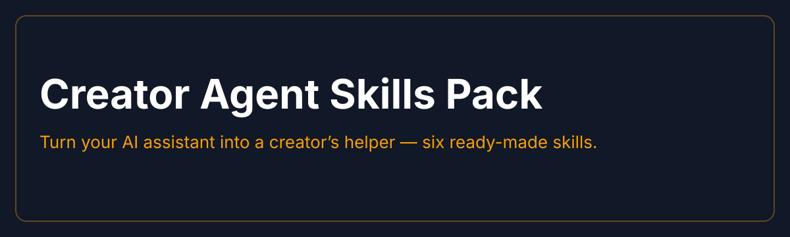

# Creator Agent Skills Pack 🎬

 

**Turn your AI assistant into a creator's helper — six ready-made skills
for YouTube, repurposing, SEO and more.** No code. No API. No key. Each
skill is a single `SKILL.md` file: when to use it, the exact workflow,
checklists, templates, and the mistakes not to make.

## Install

One command per agent. The `install.sh` script in this repo does the
copying — no network or API key needed.

| Agent | One command |
|---|---|
| Claude Code (default, `~/.claude/skills`) | `git clone https://github.com/mrabr381/creator-agent-skills-pack.git && cd creator-agent-skills-pack && ./install.sh` |
| Any agent, project-local | `./install.sh --dir .claude/skills` |
| Any other agent | `./install.sh --dir /path/to/your-agent/skills` |
| Via skills.sh | `npx skills add mrabr381/creator-agent-skills-pack` |
| Manual (works everywhere) | `cp -r skills/repurpose-episode ~/.claude/skills/` |

Then invoke a skill by name: "Use the repurpose-episode skill on this transcript."

## Skills index

| # | Skill | What it does |
|---|-------|--------------|
| 1 | [youtube-outlier-research](skills/youtube-outlier-research/SKILL.md) | Find outlier videos in a niche: rank by views vs channel baseline and velocity, surface the patterns that actually worked. |
| 2 | [repurpose-episode](skills/repurpose-episode/SKILL.md) | Turn one long recording into show notes, a blog post, LinkedIn + X posts, a newsletter, chapters and pull quotes — without inventing anything. |
| 3 | [seo-geo-audit](skills/seo-geo-audit/SKILL.md) | Audit a page for classic SEO and for AI-search (GEO) citation readiness: llms.txt, FAQ/schema, facts, structure, links, speed. |
| 4 | [digital-product-packaging](skills/digital-product-packaging/SKILL.md) | Research, outline, write, format and package a digital product (guide, template, checklist) ready to sell. |
| 5 | [thumbnail-title-test](skills/thumbnail-title-test/SKILL.md) | Generate title + thumbnail variants, score them on a fixed rubric, and keep a test log so winners compound. |
| 6 | [privacy-tool-review](skills/privacy-tool-review/SKILL.md) | Review a privacy tool before recommending or shipping it: threat model, data flow, secrets, encryption claims, permissions. |

Full index with companion repos: [SKILLS.md](SKILLS.md).

## Before / after

**Before — one 14-minute episode, used once:** 1 YouTube video, 1 podcast
episode… then the transcript sits in a folder, unused.

**After — the same episode, run through the repurpose-episode skill:**
show notes, blog post, LinkedIn post, X thread (8 posts, each ≤ 280
chars), newsletter, chapters with real timestamps, verbatim pull quotes —
all in one pack. One worked example per skill lives in `examples/`.

## How a skill is written

Every `SKILL.md` has the same shape: YAML frontmatter (`name` +
`description`), **When to Use**, **Workflow**, **Checklist**, **Templates**,
**Anti-Patterns**. First rule in every skill: **never invent numbers,
quotes, or sources.**

## Companion repos

These skills are the instruction layer for the free creator tools in the
same series by [mrabr381](https://github.com/mrabr381) — they drive the
tools, or work the same workflow by hand when a tool is not installed.

| Skill | Companion repo |
|-------|---------------|
| youtube-outlier-research | `open-vidiq` — YouTube Data API research agent |
| repurpose-episode | `creator-repurpose-agent` — transcript → 7 outputs in one run |
| seo-geo-audit | `geo-visibility-checker` — AI-search brand tracker |
| digital-product-packaging | `Digital-Product-Agent` — researches and packages digital products |
| thumbnail-title-test | — (works standalone) |
| privacy-tool-review | `Hidden-Chat-` — privacy-first messenger, worked reference |

> Companion repos are being published in order, so a link may 404 briefly
> until its push lands. Every skill works standalone until then.

## Honest limitations

- **Skills are instructions, not software.** They cannot fetch YouTube data,
  transcribe audio, or call an API — they tell an agent (or you) how to do
  it, and point at the companion tools that do the heavy lifting.
- **The GEO advice is new and moving.** AI-search citation behaviour changes
  often; `seo-geo-audit` checks durable signals (llms.txt, FAQ/schema,
  verifiable facts, clear structure), not rankings.
- **Free-tier keys are bring-your-own.** Companion tools use your own
  free-tier Gemini/YouTube key in your own `.env` — the skills never ask
  for one and never contain one.

## Contributing

Keep each skill self-contained (one job, one folder, no cross-skill
dependencies). Every new skill needs a worked example in `examples/` and
must pass `python3 validate.py`. No invented numbers, quotes, or sources.

## License

MIT — see [LICENSE](LICENSE). Copyright © 2026 Muhammad AbuBakar Azam.

---

> Why this exists: the biggest skill packs on GitHub in November 2026 are
> all software-engineering workflows — [mattpocock/skills](https://github.com/mattpocock/skills)
> (327k stars, +19.1k in November 2026), obra/superpowers (321k),
> anthropics/skills (197k). Star counts are a November 2026 research
> snapshot, not a live fact. No creator-focused pack existed. This is that
> pack.
